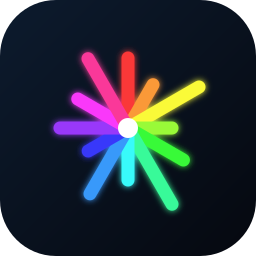
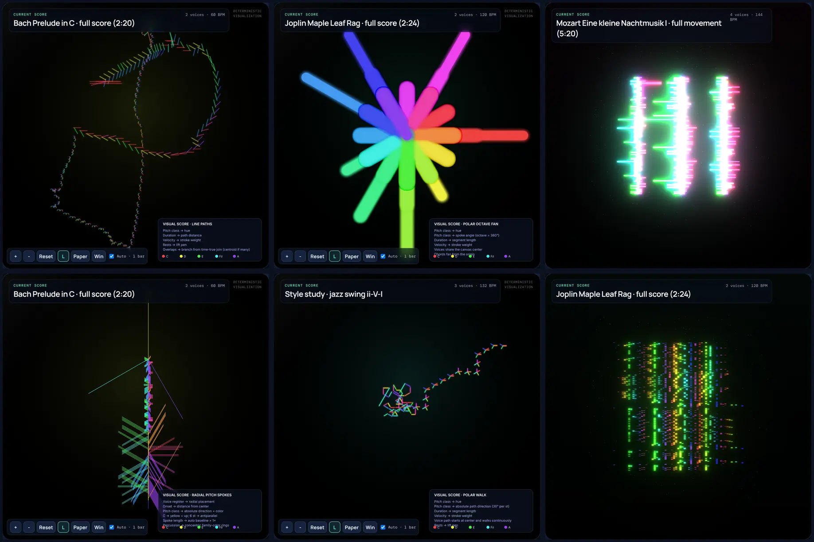
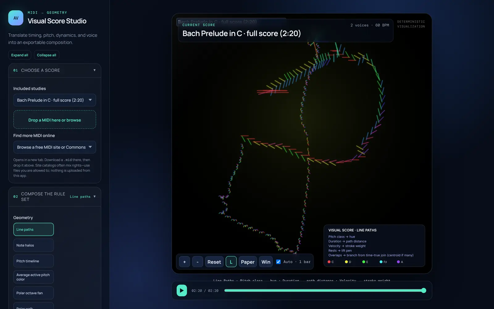
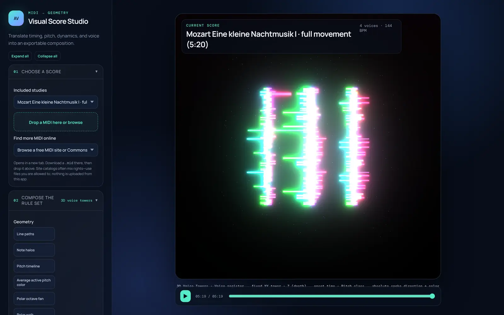

<p align="center">
  
</p>

<h1 align="center">AudioVisualizer</h1>

<p align="center"><strong>Music → visual score art.</strong> Turn MIDI files into deterministic, reproducible geometric artwork and animations.</p>

<p align="center">
  <a href="https://github.com/kgrizz-git/audiovisualizer/actions/workflows/ci.yml"></a>
  <a href="https://github.com/kgrizz-git/audiovisualizer/actions/workflows/zizmor.yml"></a>
  <a href="VERSION"></a>
  <a href="LICENSE"></a>
  
  
  
</p>

Last reviewed: 2026-10-19

<p align="center">
  
</p>

## What it is

AudioVisualizer reads a MIDI file and draws it. Every mark comes from an explicit rule:
pitch, duration, interval, velocity and voice each map to color, length, direction, weight
or placement. The same file and settings always produce the same picture.

- **Visual Score Studio** (browser): pick a score, compose a rule set, play it back with
  audio, and export.
- **CLI**: render the same compositions to SVG or PNG without opening the studio.
- **Offline-first**: uploaded MIDI never leaves the browser.

<table>
  <tr>
    <td></td>
    <td></td>
  </tr>
</table>

## Visual modes

| 2D (SVG-capable) | 3D (Three.js, browser only) |
| --- | --- |
| Line paths · Note halos · Pitch timeline | 3D line paths · Note halos · Note spheres |
| Average active pitch color | Piano-roll slab · Voice towers |
| Polar octave fan · Polar walk | 3D polar octave fan · 3D polar walk |
| Radial voice paths · Radial pitch spokes | 3D radial voice paths |

In 3D, drag to orbit, scroll to zoom and right-drag (or two-finger drag) to pan. Choose a
now-plane or a cumulative reveal for playback, and capture the view as PNG or a six-second
WebM. SVG export and the CLI stay 2D-only.

Every mode and control is mapped exactly in [docs/modes.md](docs/modes.md). In the studio,
select **Summary** beneath the Compose controls to see the active rule set and its values.
More renders live in [`docs/images/modes/`](docs/images/modes/).

## Quick start

```bash
npm install        # install dependencies
npm run dev        # start the studio (Vite)
npm run validate   # lint, tests with coverage, type-check, production build
```

### Music to try

The studio ships with classical and ragtime scores (Bach, Mozart, Beethoven, Joplin,
Bowman) and original style studies (blues, jazz, funk, electronic, hip-hop, rock, house).
**Find more MIDI online** links to FreeMIDI.org, BitMidi, Mutopia, Wikimedia Commons and
similar catalogs: download a `.mid` and drop it into the studio. Rights vary by file and
site, and commercial songs are not redistributed with the app.

## Command-line rendering

Generate deterministic SVG or PNG without starting the studio:

```bash
npm run render -- --input ./song.mid --output ./song.svg --mode tonal_time_lines --height 2400 --legend --manifest ./song.json
```

Use a `.png` output filename to rasterize the same composition at the requested size:

```bash
npm run render -- --input ./song.mid --output ./song.png --width 2400 --height 2400
```

The CLI shares the studio's MIDI parser, mapping rules, fitting and SVG renderer. Run
`npm run render -- --help` for every option, including voice filtering, pitch-color and
origin rules, plotter SVG, custom dimensions and tonal time-line density. The optional
manifest records the normalized score and exact rule configuration, so a render can be
reproduced later.

## Audio preview

<details>
<summary>SoundFont playback, voice routing and bundled samples</summary>

Alongside its oscillator preview, the studio has a sample-based General MIDI SoundFont
engine. Tracks that share a channel but use different programs load their own instrument
patches. Percussion (MIDI channel 10, zero-indexed 9) plays through the bundled FluidR3
Standard drum kit. Other drum kits (Room, Power, Electronic, Jazz, Brush and so on) are
deferred to the planned SF2 synth engine.

To bundle the standard FluidR3 GM samples and the Standard drum kit for offline use:

```bash
npm run bundle:soundfonts
```

The other soundbank presets (MusyngKite, FatBoy) fetch samples from a CDN on demand when
selected.

Each voice row shows both the MIDI file's source instrument and the route the preview
actually uses. Changing a route during playback restarts the preview at the playhead, so
what you hear matches the controls. Solo is exclusive and mutes the other voices; a voice
can't be muted and soloed at once.

Bundled samples and the Standard drum kit are derived from the Fluid R3 SoundFont by Frank
Wen, licensed under [CC BY 3.0](https://creativecommons.org/licenses/by/3.0/). See
[`public/soundfonts/LICENSE.txt`](public/soundfonts/LICENSE.txt).

</details>

## Documentation

- [docs/vision.md](docs/vision.md): founding concept, mapping thesis, variations and roadmap.
- [DESIGN.md](DESIGN.md): the visual language and normative rule semantics.
- [docs/modes.md](docs/modes.md): mode-by-mode, control-by-control mapping reference.
- [ARCHITECTURE.md](ARCHITECTURE.md): stack, data flow, offline boundary, CLI and planned
  desktop packaging.

## Contributing

Suggestions, bug reports and feature requests are welcome as
**[GitHub Issues](https://github.com/kgrizz-git/audiovisualizer/issues)**.

**Pull requests are not solicited right now.** The project is in an early public phase and
maintainer time is limited, so unsolicited PRs may be closed without merge. If you have a
concrete change in mind, open an issue first so we can decide whether to take it on.

Security vulnerabilities: see [`SECURITY.md`](SECURITY.md). Report privately; don't file
public issues for vulnerabilities.

## Licenses

AudioVisualizer is [MIT-licensed](LICENSE). Direct and transitive npm dependency licenses
are cataloged in [`inventory/third-party-licenses.md`](inventory/third-party-licenses.md)
(policy: [`policies/third-party-licenses.md`](policies/third-party-licenses.md)).
Regenerate after dependency changes:

```bash
python hooks/scripts/check_license_inventory.py --update
python hooks/scripts/check_license_inventory.py --human-review
```
